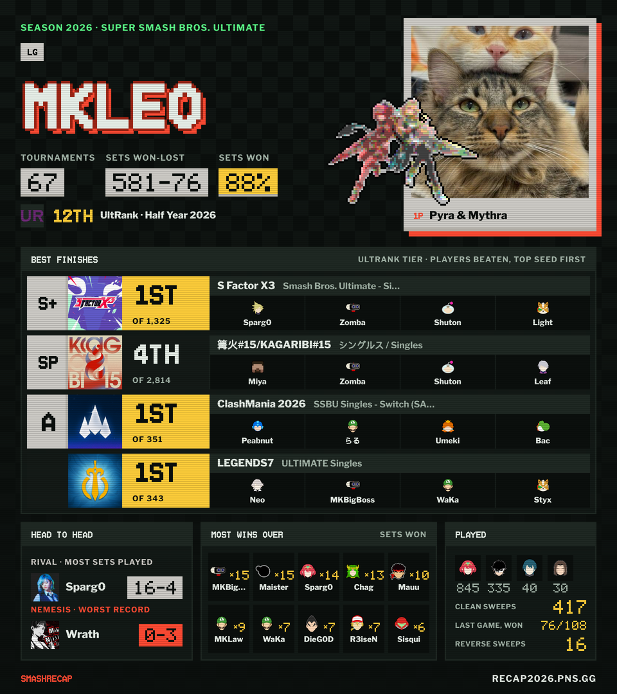
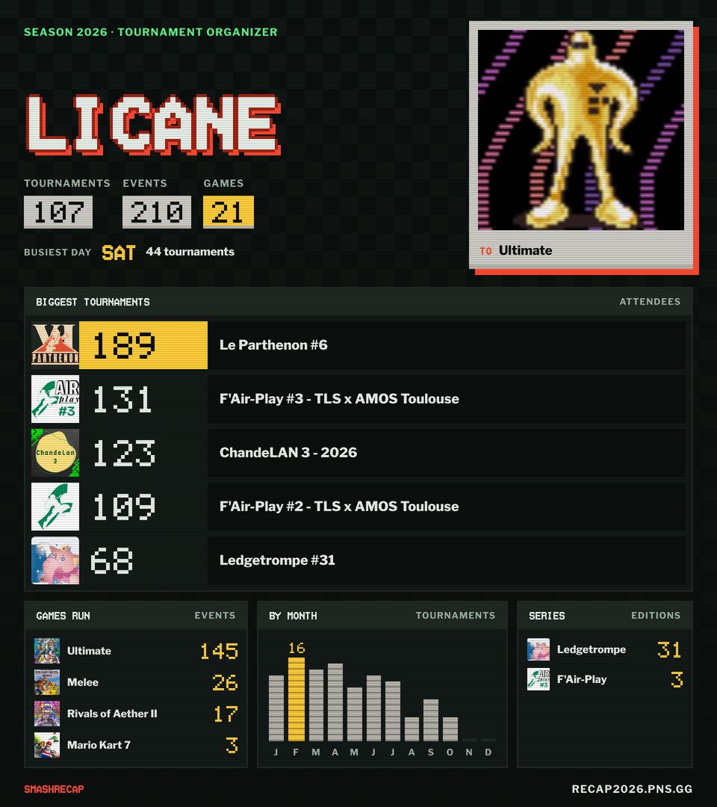

# SmashRecap 2026

Your 2026 season on start.gg, as a recap. Search a player or a tournament organizer and get their year: results,
best finishes, rivals, characters, and as an organizer the tournaments, games and series they ran. Each recap
plays as an animated video in the browser and downloads as one image to post.

Live at [recap2026.pns.gg](https://recap2026.pns.gg).

<p align="center">
  
  
</p>

Games covered: Super Smash Bros. Ultimate, Melee, Brawl, Rivals of Aether and Rivals of Aether II.

## How it works

A Bun monorepo:

| Path | What it is |
|---|---|
| `apps/api` | [Elysia](https://elysiajs.com) API on Bun. Fetches a season from start.gg, computes the recap, caches it in Redis. In production it also serves the website. |
| `apps/web` | The website, [React Router](https://reactrouter.com) in framework mode (server rendered), with link-preview images. |
| `apps/remotion` | The recap video and the downloadable image, made with [Remotion](https://www.remotion.dev). The website plays and renders them in the browser. |
| `packages/shared` | Types, the list of games and sample recaps shared by the other packages. |

```
browser ──► web (React Router) ──► api (Elysia) ──► start.gg
               │                      │
               └── Remotion player     └── Redis (recaps cached 24 h, season stats)
```

The API reads start.gg's public site endpoint, so **no start.gg API key is needed**.

## Requirements

- [Bun](https://bun.sh) 1.x
- Redis 7, for the cache and the season stats (`docker compose up redis` starts one)
- Docker, only to build or run the production image
- **The UltRank database**, only to update tournament tiers (see [UltRank tiers](#ultrank-tiers)). The
  repository already has the imported data, so you don't need it to run the app.

## Getting started

```bash
bun install
docker compose up -d redis
```

Then run the API and the website in two terminals:

```bash
# apps/api: the API on http://localhost:3001
cd apps/api
RECAP_YEAR=2026 bun run dev
```

```bash
# apps/web: the website on http://localhost:5173, talking to the API above
cd apps/web
API_URL=http://localhost:3001 VITE_API_URL=http://localhost:3001 bun run dev
```

Open http://localhost:5173 and search a player.

To work on the video or the image alone, with sample data:

```bash
cd apps/remotion
bun run dev        # Remotion Studio
```

### Environment variables

| Variable | Used by | Default | What it does |
|---|---|---|---|
| `RECAP_YEAR` | api | none, required | The season the recaps cover. |
| `PORT` | api, web | `3001` | The API's port. The web server also uses it to reach the API on the same machine. |
| `REDIS_URL` | api | `redis://localhost:6379` | Redis for the cache and the season stats (read by Bun). |
| `WEB_BUILD_DIR` | api | `../web/build` | The website build the API serves. When it is missing, the API serves the API only. |
| `API_URL` | web (server) | `http://localhost:$PORT` | Where the website's server finds the API. |
| `VITE_API_URL` | web (browser) | the site's own origin | Where the browser finds the API. Only needed in development, when they are on different ports. |
| `SITE_URL` | web | the request's origin | The public address used in link previews. Set it in production. |

## API

All under `/api/v1`:

| Route | Returns |
|---|---|
| `GET /players/search?gamertag=…` | Players matching a tag. |
| `GET /players/:slug/recap?videogameId=…` | A player's recap for one game (`1386` is Ultimate). |
| `GET /players/:slug/summary` | A short summary of the player, for link previews. |
| `GET /tournament-organizers/:slug/recap` | An organizer's recap. |
| `GET /tournament-organizers/:slug/summary` | A short summary of the organizer. |
| `GET /stats` | How many recaps were made this season. |

`:slug` is the start.gg user slug (the `user/xxxxxxxx` part of a profile URL).

## UltRank tiers

In Ultimate, a player's best finishes show the tournament's **UltRank tier** (SP, P+, P, S+, S, A+, A, B+, B, C, D),
like UltRank's own player cards. Events UltRank does not rank (too small, weeklies, other games, or newer than the
last import) show none.

The scores come from UltRank's season database,
[kenniky/ultrank-database](https://github.com/kenniky/ultrank-database) (`ur_db_2026.zip`, a SQLite file). The tier
thresholds come from [SmashWiki's UltRank 2026 page](https://www.ssbwiki.com/UltRank_2026), since the database only
stores scores. Both are kept in `apps/api/src/libs/ultrank/`.

The API doesn't read the database itself. A script imports it into `tournaments.json`, which is committed and bundled
with the server. When a new database is published:

1. Download the latest `ur_db_2026.zip` and unzip it.
2. Import it:

   ```bash
   cd apps/api
   bun run ultrank:import ~/Downloads/ur_db_2026.db
   ```

3. Commit `apps/api/src/libs/ultrank/tournaments.json` and deploy. Cached recaps expire within a day, then show the
   new tiers.

Keep the `.db` file out of the repository.

## Tests

```bash
bun run typecheck   # every package
bun run test        # every package
```

CI runs both on every pull request and builds the Docker image.

## Production

One container serves the API and the website:

```bash
docker build -f apps/api/Dockerfile -t smash-recap .
```

Or run it with Redis through Docker Compose, the app on http://localhost:3003:

```bash
RECAP_YEAR=2026 SITE_URL=https://recap2026.pns.gg docker compose up --build
```

The compose file also starts RedisInsight on http://127.0.0.1:5540 to look into the cache.

Releases are made with [release-please](https://github.com/googleapis/release-please): merging its pull request
on `main` tags a version and publishes the image to the GitHub Container Registry.

## Credits

- Data: [start.gg](https://www.start.gg).
- Tournament tiers: [UltRank](https://www.ssbwiki.com/UltRank), through
  [kenniky/ultrank-database](https://github.com/kenniky/ultrank-database).
